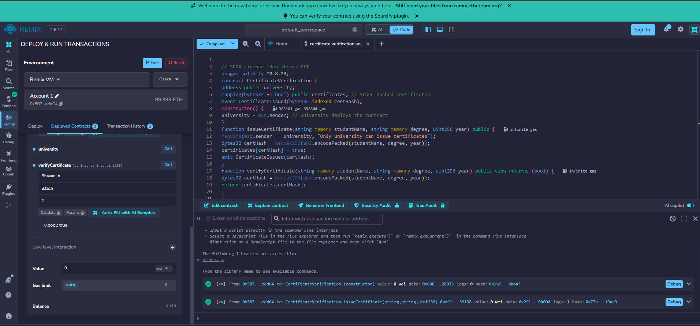

# Experiment 1: Decentralized Certificate Verification

# Aim:

To develop a smart contract for issuing and verifying academic certificates on Ethereum, preventing forgery and ensuring authenticity.

# Algorithm:

Deploy a smart contract where universities can issue certificates.
Store a hash of certificate data on-chain.
Provide a verification function that checks certificate authenticity.
Users can verify the certificate by comparing the stored hash.

# Program:

```
// SPDX-License-Identifier: MIT
pragma solidity ^0.8.20;
contract CertificateVerification {
address public university;
mapping(bytes32 => bool) public certificates; // Store hashed certificates
event CertificateIssued(bytes32 indexed certHash);
constructor() {
university = msg.sender; // University deploys the contract
}
function issueCertificate(string memory studentName, string memory degree, uint256 year) public {
require(msg.sender == university, "Only university can issue certificates");
bytes32 certHash = keccak256(abi.encodePacked(studentName, degree, year));
certificates[certHash] = true;
emit CertificateIssued(certHash);
}
function verifyCertificate(string memory studentName, string memory degree, uint256 year) public view returns (bool) {
bytes32 certHash = keccak256(abi.encodePacked(studentName, degree, year));
return certificates[certHash];
}
}
```

# Output:



# Result:

The certificate verification experiment is implemented successfully
